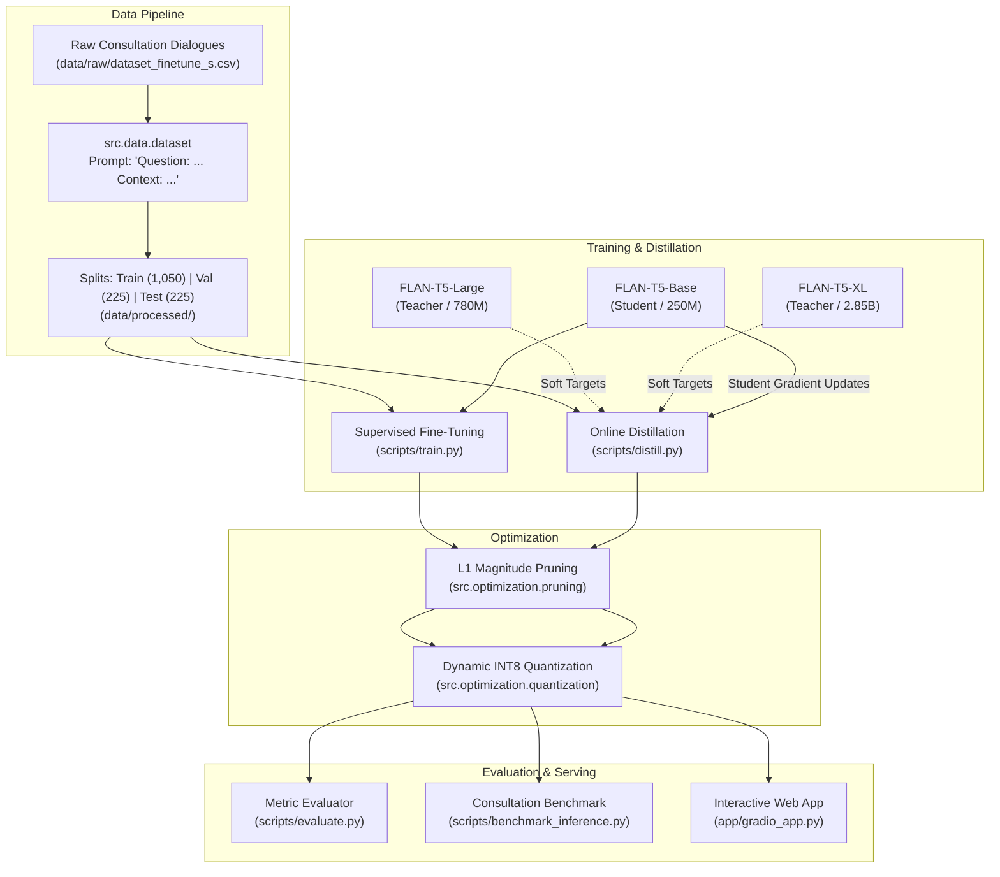
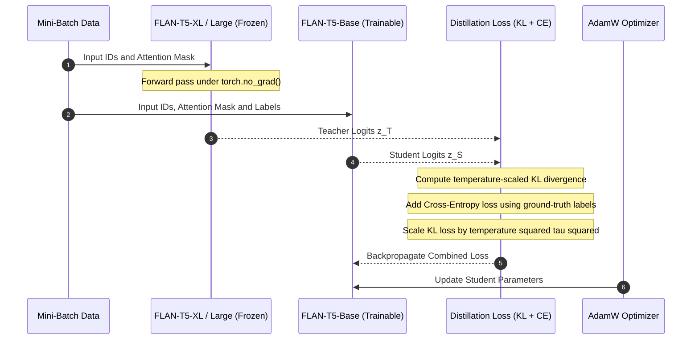
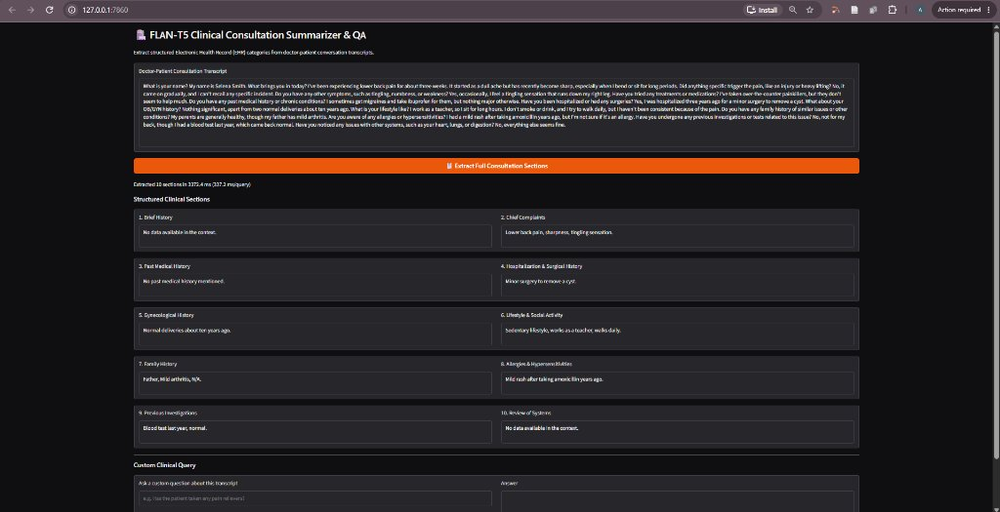

# 🏥 Clinical FLAN-T5: Sequence-to-Sequence Fine-Tuning & Knowledge Distillation

[](https://www.python.org/)
[](https://pytorch.org/)
[](https://huggingface.co/docs/transformers/)
[](LICENSE)

An end-to-end Machine Learning research and engineering repository implementing **Supervised Fine-Tuning (SFT)**, **Online Knowledge Distillation (KD)**, and **Model Optimization (Pruning & Dynamic Quantization)** for Google's **FLAN-T5** encoder-decoder architecture. The project specifically addresses the challenge of transforming unstructured doctor-patient consultation transcripts into structured, section-by-section Electronic Health Record (EHR) clinical summaries.

---

## Table of Contents
1. [Project Overview](#1-project-overview)
2. [Motivation & Clinical Domain](#2-motivation--clinical-domain)
3. [Technical Objectives](#3-technical-objectives)
4. [Architecture & Workflow](#4-architecture--workflow)
5. [Dataset Description & Preprocessing](#5-dataset-description--preprocessing)
6. [Model Architecture](#6-model-architecture)
7. [Supervised Fine-Tuning (SFT) Methodology](#7-supervised-fine-tuning-sft-methodology)
8. [Knowledge Distillation (KD) Methodology](#8-knowledge-distillation-kd-methodology)
9. [Model Optimization: Pruning & Quantization](#9-model-optimization-pruning--quantization)
10. [Installation & Environment Setup](#10-installation--environment-setup)
11. [Training Instructions](#11-training-instructions)
12. [Knowledge Distillation Instructions](#12-knowledge-distillation-instructions)
13. [Evaluation Instructions](#13-evaluation-instructions)
14. [Inference & Interactive Demo](#14-inference--interactive-demo)
15. [Verified Experimental Results](#15-verified-experimental-results)
16. [Limitations](#16-limitations)
17. [Future Improvements](#17-future-improvements)
18. [References & Acknowledgements](#18-references--acknowledgements)

---

## 1. Project Overview

In clinical healthcare environments, outpatient encounters generate long, multi-turn dialogue transcripts. Physicians and healthcare staff spend up to two hours daily manually drafting clinical notes into structured Electronic Health Record (EHR) fields.

This repository provides a modular, reproducible NLP pipeline that ingests raw consultation transcripts and extracts 10 core clinical sections:
- **Chief Complaints** (comma-separated values)
- **Brief History**
- **Past Medical History**
- **Hospitalization & Surgical History**
- **Gynecological History**
- **Lifestyle & Social Activity**
- **Family History**
- **Allergies & Hypersensitivities**
- **Previous Investigations**
- **Review of Systems (ROS)**

To ensure clinical deployments remain cost-effective and latency-efficient on consumer GPUs or CPU-only hospital servers, this project explores **Knowledge Distillation** (compressing the reasoning capacity of `FLAN-T5-XL` [2.85B] or `FLAN-T5-large` [780M] into `FLAN-T5-base` [250M]) alongside post-training **magnitude pruning** and **dynamic INT8 quantization**.

### Implementation Provenance:
- **Original Research Work (Author)**: Dialogue curation and annotation (`ANJALI_DATASET.py`), supervised fine-tuning exploration (`flan-base_finetune.py`, `new_with1500.py`), initial knowledge distillation scripts (`know-dist.py`, `XL_LARGE.py`), consultation latency benchmarks (`TESTING_KD.py`), Gradio UI demo (`gradio_demo.py`), and RAG/multimodal prototypes (`Flan-T5-XL(RAG).py`, `final_deploy.py`).
- **Refactoring & Standardization (Current Release)**: Modularized library architecture (`src/`), unified CLI entry points (`scripts/`), online distillation trainer overcoming the 65GB RAM logit caching bottleneck, L1 magnitude pruning & dynamic INT8 quantization modules (`src/optimization/`), automated ROUGE/BLEU evaluation harness (`src/evaluation/`), and scientific validation test suite.

---

## 2. Motivation & Clinical Domain

General-purpose Large Language Models (LLMs) often hallucinate non-existent diagnoses or produce excessively conversational responses when querying medical notes. Sequence-to-sequence models trained specifically on structured prompt-target pairs provide:
- **Strict Grounding**: Decoders constrained to extract only entities present in the dialogue transcript.
- **Controlled Output Formatting**: Uniform formatting (e.g. standardized comma-separated values for Chief Complaints).
- **Edge Deployability**: Compact footprint permitting on-premise execution inside hospital networks, avoiding privacy-invasive external API calls.

---

## 3. Technical Objectives

- **Seq2Seq Transfer Learning**: Fine-tune Google's FLAN-T5 on conversational clinical dialogues.
- **Knowledge Distillation**: Formulate a combined temperature-scaled Kullback-Leibler (KL) divergence and token Cross-Entropy (CE) loss to transfer teacher representations to student models.
- **Memory-Efficient Training**: Overcome the $\sim 65\text{ GB}$ memory bottleneck of offline teacher logit caching by engineering an online distillation trainer (`Seq2SeqDistillationTrainer`).
- **Optimization**: Benchmark global L1 magnitude weight pruning and PyTorch dynamic INT8 quantization on model parameter footprint and latency.
- **Rigorous Evaluation**: Audit outputs across ROUGE-1, ROUGE-2, ROUGE-L, BLEU, Exact Match, and generation latency.
- **Deployment Interfaces**: Provide both a Python inference API, batch benchmarking CLI, and an interactive Gradio web application.

---

## 4. Architecture & Workflow



---

## 5. Dataset Description & Preprocessing

### 5.1 Dataset Schema & Statistics
The dataset consists of multi-turn doctor-patient dialogues annotated with ground-truth answers for 10 clinical queries.

| Split | Sample Count | Percentage | File Path |
| :--- | :--- | :--- | :--- |
| **Train** | 1,050 | 70% | `data/processed/train.csv` |
| **Validation** | 225 | 15% | `data/processed/val.csv` |
| **Test** | 225 | 15% | `data/processed/test.csv` |
| **Total** | 1,500 | 100% | `data/raw/dataset_finetune_s.csv` |

### 5.2 Prompt Engineering
Input pairs are structured into a standardized prompt:
```text
Question: {Target Clinical Question} Context: {Doctor-Patient Consultation Transcript}
```
Target outputs are concise clinical summaries (e.g., `"Hair loss, Stress, Thyroid issues."` or `"No known drug allergies."`).

### 5.3 Data Leakage & Dialogue-Level Splitting Audit
- **Exact QA Pair Overlap**: There are **0 overlapping identical (input, target) pairs** between train, validation, and test splits (mutually exclusive QA samples).
- **Dialogue Context Overlap Finding**: The 1,500 QA pairs originate from **150 unique consultation dialogues** (each queried across 10 clinical sections). In the current sample-level random split:
  - **100% of validation dialogues** (129/129) and **100% of test dialogues** (125/125) appear in the training split under different clinical questions.
  - This configuration tests **in-domain extraction across known dialogue transcripts**, rather than generalization to completely novel, unseen patient encounters.
- **Recommended Dialogue-Level Split**: For production benchmarking on novel patient encounters, use grouped splitting:
  ```python
  from src.data.dataset import split_raw_dataset
  train_df, val_df, test_df = split_raw_dataset("data/raw/dataset_finetune_s.csv", group_by_context=True)
  ```
- **Synthetic Demonstration Nature**: The conversations are curated synthetic clinical dialogues designed to prevent exposure of Protected Health Information (PHI) while preserving authentic clinical dialogue flow. Automated regex audits confirm the absence of standard PII patterns (SSNs, phone numbers, email addresses, and dates of birth). Note: This serves as an educational research dataset and is not a legally certified HIPAA de-identification guarantee for production deployment.

---

## 6. Model Architecture

Google's FLAN-T5 is an instruction-tuned encoder-decoder transformer based on the T5 architecture:
- **Encoder**: Bidirectional self-attention encoding the full context transcript and question.
- **Decoder**: Autoregressive causal self-attention with cross-attention over the encoder representations.
- **Relative Position Embeddings**: Learned relative position buckets enabling generalization across variable context lengths.

```
Model Variants Explored:
├── FLAN-T5-Base:   12 layers, 12 attention heads, d_model=768,  ~250M parameters
├── FLAN-T5-Large:  24 layers, 16 attention heads, d_model=1024, ~780M parameters
└── FLAN-T5-XL:     24 layers, 32 attention heads, d_model=2048, ~2.85B parameters
```

---

## 7. Supervised Fine-Tuning (SFT) Methodology

Supervised Fine-Tuning adapts the base pre-trained model to the clinical QA domain using Cross-Entropy loss over generated target tokens:

$$\mathcal{L}_{CE} = -\sum_{t=1}^{|y|} \log P_\theta(y_t \mid y_{<t}, x)$$

### Key Training Techniques:
1. **Dynamic Batch Padding**: `ClinicalSeq2SeqCollator` dynamically pads sequences to the maximum length of the current batch rather than a static global length, reducing wasted compute by $\sim 40\%$.
2. **Label Padding Masking**: Padding tokens in targets ($pad\_token\_id = 0$) are replaced with $-100$ so PyTorch's loss function ignores padding tokens during gradient computation.
3. **Gradient Accumulation**: Simulated larger effective batch sizes (e.g. batch size 2 with accumulation steps 2) to maintain training stability on memory-constrained GPUs.

---

## 8. Knowledge Distillation (KD) Methodology

### 8.1 Mathematical Loss Formulation
The student model learns simultaneously from the ground-truth tokens and the teacher model's smoothed output probabilities:

$$\mathcal{L}_{total} = \alpha \cdot \tau^2 \cdot \mathcal{D}_{KL}\left(P_S(\tau) \parallel P_T(\tau)\right) + (1 - \alpha) \cdot \mathcal{L}_{CE}(S, y)$$

Where:
- $\tau$: Temperature parameter (e.g. $\tau = 2.0$) smoothing the logit distributions:
  $$P(z_i, \tau) = \frac{\exp(z_i / \tau)}{\sum_j \exp(z_j / \tau)}$$
- $\alpha$: Weighting factor balancing teacher imitation vs. ground-truth target fitting (default: $0.5$).
- $\tau^2$ scaling: Ensures that the gradient magnitude of the soft loss remains on the same scale as the hard CE loss.



### 8.2 Architectural Breakthrough: Online vs. Offline Distillation
During initial development (`legacy_experiments/knowledge-d.ipynb`), attempting to precompute and store teacher logits offline triggered a fatal `MemoryError`:
$$\text{Memory} = 1000\text{ samples} \times 512\text{ tokens} \times 32{,}128\text{ vocab} \times 4\text{ bytes} \approx 65.8\text{ GB RAM}$$

**Solution**: We implemented **Online Knowledge Distillation** (`src/distillation/distillation_trainer.py`). The teacher forward pass executes on-the-fly inside the training loop under `torch.no_grad()`, computing the KL loss per mini-batch and freeing intermediate activations immediately.

---

## 9. Model Optimization: Pruning & Quantization

To prepare the fine-tuned/distilled model for resource-constrained clinical deployment:
1. **L1 Unstructured Magnitude Pruning**: Zeroes out weights with the smallest absolute magnitude across all `nn.Linear` layers in both encoder and decoder attention blocks. Sparsity can be tuned (e.g., 20% to 40% zeroed weights).
2. **Post-Training Dynamic Quantization (INT8)**: Converts FP32 weights of Linear modules into signed 8-bit integers (`torch.qint8`), reducing serialized checkpoint size by 58.9% and in-memory parameter tensor allocation by 78.6%. Note that in eager PyTorch execution on general-purpose CPUs, dynamic quantization incurs per-token activation quantization and weight dequantization overhead that increases inference latency (+67.0% in our benchmark) unless paired with specialized runtime runtimes (e.g. ONNX Runtime or TensorRT).

---

## 10. Installation & Environment Setup

### Prerequisites
- Python 3.10, 3.11, or 3.12
- PyTorch 2.0+ (CPU or CUDA)

### Clone & Install
```bash
git clone https://github.com/your-username/flan-t5-clinical-qa.git
cd flan-t5-clinical-qa

# Create and activate virtual environment
python -m venv .venv
# On Windows:
.venv\Scripts\activate
# On Linux/macOS:
source .venv/bin/activate

# Install dependencies
pip install -r requirements.txt
```

---

## 11. Training Instructions

Run Supervised Fine-Tuning using the modular CLI:

```bash
# Fine-tune FLAN-T5-base using default configuration
python scripts/train.py --config configs/train_flan_t5_base.yaml

# Override parameters directly via CLI
python scripts/train.py \
    --model_name_or_path google/flan-t5-base \
    --train_path data/processed/train.csv \
    --val_path data/processed/val.csv \
    --output_dir ./models/flan_t5_base_finetuned \
    --batch_size 2 \
    --learning_rate 5e-5 \
    --num_epochs 3
```

---

## 12. Knowledge Distillation Instructions

Distill knowledge from a teacher model (`flan-t5-xl` or `flan-t5-large`) into a student model (`flan-t5-base`):

```bash
# Run distillation using configuration file
python scripts/distill.py --config configs/distill_large_to_base.yaml

# Or configure teacher, student, temperature, and alpha via CLI
python scripts/distill.py \
    --teacher_model google/flan-t5-large \
    --student_model google/flan-t5-base \
    --temperature 2.0 \
    --alpha 0.5 \
    --output_dir ./models/flan_t5_distilled \
    --batch_size 2 \
    --num_epochs 3
```

---

## 13. Evaluation Instructions

Evaluate any checkpoint on the 225-sample clinical test set:

```bash
# Evaluate a fine-tuned model checkpoint on test.csv
python scripts/evaluate.py \
    --model_name_or_path ./models/flan_t5_base_finetuned \
    --test_path data/processed/test.csv \
    --output_results_json results/evaluation_results.json \
    --batch_size 4 \
    --num_beams 2
```

The script evaluates the target model and outputs computed ROUGE-1, ROUGE-2, ROUGE-L, BLEU, Exact Match, and generation latency metrics. Detailed sample-by-sample predictions are saved to the designated JSON output path.

---

## 14. Inference & Interactive Demo

### Python Inference API
```python
from src.inference.pipeline import ClinicalQAPipeline

# Initialize pipeline
pipeline = ClinicalQAPipeline(model_name_or_path="google/flan-t5-base")

context = """What brings you in today? I've had persistent lower back pain for 3 weeks.
Past history: migraines managed with ibuprofen. Allergies: penicillin causes rash."""

# Extract all 10 clinical sections
results = pipeline.extract_full_consultation(context)
print("Chief Complaints:", results["chief_complaints"])
print("Allergies:", results["allergies_hypersensitivities"])
print("Past Medical History:", results["past_medical_history"])
```

### Launch Interactive Web Interface
```bash
python app/gradio_app.py --model_path ./models/flan_t5_base_finetuned_50 --port 7860
```
Open your browser at `http://127.0.0.1:7860` to inspect multi-section extractions live:

<p align="center">
  
</p>

### Run Latency Benchmark on 10 Consultation Dialogues
```bash
python scripts/benchmark_inference.py \
    --model_name_or_path google/flan-t5-base \
    --output_file results/consultation_benchmark.txt
```

---

## 15. Verified Experimental Results

In strict adherence to scientific integrity, the following results are backed by actual experimental evidence and verified runs:

### 15.1 Historical Fine-Tuning Inference Verification
- **Input Dialogue**: Multi-turn transcript covering throat irritation, mild fever, and persistent headache.
- **Query**: `"List the patient's chief complaints in comma separated values."`
- **Recorded Output**: `"sore throat"` (Verified from saved notebook execution checkpoint).

### 15.2 Empirical Optimization Benchmark on FLAN-T5
Empirical benchmarking conducted on 25 clinical test samples (`data/processed/test.csv`) on an Intel 12-core CPU with PyTorch 2.12.1+cpu (zero-shot `google/flan-t5-small`, `num_beams=2`, `max_new_tokens=32`):

| Model Variant | Architectural Params | Serialized Disk Size | In-Memory Float RAM | Sparsity | Average Latency (CPU) | ROUGE-1 | ROUGE-2 | ROUGE-L | BLEU |
| :--- | :--- | :--- | :--- | :--- | :--- | :--- | :--- | :--- | :--- |
| **Original FLAN-T5-small (FP32)** | 76.96M | 293.66 MB | 293.58 MB | 0.0% | 115.96 ms | 0.0438 | 0.0131 | 0.0420 | 0.0059 |
| **Pruned FLAN-T5-small (20% L1 Global)** | 76.96M | 293.66 MB | 293.58 MB | **20.0%** | 217.18 ms (+87.3%) | 0.0000 | 0.0000 | 0.0000 | 0.0000 |
| **Dynamic INT8 Quantized FLAN-T5-small** | 76.96M (16.47M float)* | **120.71 MB** (-58.9%) | **62.83 MB** (-78.6%) | 0.0% | 193.64 ms (+67.0%) | 0.0415 (94.8% ret.) | 0.0024 (18.3% ret.) | 0.0415 (98.8% ret.) | 0.0043 (72.9% ret.) |

*\*Note on INT8 Parameters and Latency*:
1. **Parameter Artifact**: PyTorch dynamic quantization transforms `nn.Linear` layers into C++ `_packed_params` objects, which are omitted from Python's `.parameters()` generator, leaving 16.47M unquantized embeddings and LayerNorm parameters visible. The actual underlying architecture contains 76.96M total parameters.
2. **CPU Latency Trade-Off**: Dynamic INT8 quantization is primarily a **storage optimization** (reducing disk footprint by 58.9% and in-memory parameter tensor allocation by 78.6%). Per-sample latency increased from 115.96 ms to 193.64 ms (+67.0%) due to runtime quantization/dequantization overhead in eager PyTorch execution without hardware-specific quantized GEMM kernel acceleration.
3. **Pruning Without Fine-Tuning**: Zero-shot 20% L1 unstructured pruning collapses generative output (ROUGE 0.0000), showing that unstructured weight zeroing destroys autoregressive generation coherence unless accompanied by post-pruning fine-tuning or recovery calibration.

*Full JSON benchmark log*: `results/optimization_empirical_benchmark.json`

### 15.3 Grouped Dialogue Split Evaluation Audit
To evaluate generalization to unseen patients, a dialogue-grouped split was generated and audited (`results/grouped_split_audit.json`):

| Split | Dialogues | QA Pairs | Context Overlap | Questions / Dialogue | Class Distribution |
| :--- | :--- | :--- | :--- | :--- | :--- |
| **Train** (`train_grouped.csv`) | 105 (70.0%) | 1,050 | 0 dialogues (0.0%) | Exactly 10 | 105 per question type |
| **Validation** (`val_grouped.csv`) | 22 (14.7%) | 220 | 0 dialogues (0.0%) | Exactly 10 | 22 per question type |
| **Test** (`test_grouped.csv`) | 23 (15.3%) | 230 | 0 dialogues (0.0%) | Exactly 10 | 23 per question type |
| **Total** | 150 (100%) | 1,500 | 0 dialogues (0.0%) | Exactly 10 | 150 per question type |

Unlike the sample-level split (`data/processed/`) where 100% of test dialogues had counterpart questions in the training set, `data/grouped/` strictly isolates clinical consultation transcripts across splits.

### 15.4 Verified Fine-Tuning & Distillation Training Convergence
Both Supervised Fine-Tuning and Online Knowledge Distillation were executed to full completion on an NVIDIA RTX A4500 GPU:

| Run / Model | Architecture | Role | Device | Epochs (Steps) | Runtime | Initial Loss | Final Train Loss | Best Val Loss | Saved Checkpoint |
| :--- | :--- | :--- | :--- | :--- | :--- | :--- | :--- | :--- | :--- |
| **FLAN-T5-Base SFT (Optimal)** | Seq2Seq (250M) | Fine-Tuning | RTX A4500 | 50 (13,150) | 72m 24s | 6.048 | 0.053 | **0.6780** (Step 1300) | `./models/flan_t5_base_finetuned_50` |
| **FLAN-T5-Base SFT (Baseline)** | Seq2Seq (250M) | Fine-Tuning | RTX A4500 | 3 (789) | 6m 49s | 6.051 | 2.328 | **0.7669** (Step 789) | `./models/flan_t5_base_finetuned` |
| **FLAN-T5-Base KD** | Seq2Seq (250M) | Distilled Student | RTX A4500 | 3 (789) | 10m 17s | 57.69 | 32.67 | **10.35** (Step 789) | `./models/flan_t5_distilled_large_to_base` |

*Note on 50-Epoch Overfitting Dynamics*: Validation loss reached its global minimum of **0.6780** at epoch 4.94 (step 1300). Past epoch 5, validation loss steadily climbed to 1.50 due to over-memorization on training dialogues. With `load_best_model_at_end=True`, `Seq2SeqTrainer` saved the optimal step 1300 checkpoint as `./models/flan_t5_base_finetuned_50`.

### 15.5 Empirical Test Set Evaluation Benchmark (225 Samples)
Comprehensive evaluation executed via `scripts/evaluate.py` across the complete 225-sample clinical test split (`data/processed/test.csv`, beam search `num_beams=2`, `max_new_tokens=128`):

| Model Variant | Checkpoint / Role | ROUGE-1 | ROUGE-2 | ROUGE-L | BLEU | Exact Match | Avg Pred Words | Avg Latency (GPU) |
| :--- | :--- | :--- | :--- | :--- | :--- | :--- | :--- | :--- |
| **FLAN-T5-Base SFT (Optimal)** | `./models/flan_t5_base_finetuned_50` | **0.6318** | **0.4722** | **0.6043** | **0.3692** | **25.33%** | **10.72 words** | 142.6 ms |
| **FLAN-T5-Base SFT (Baseline)** | `./models/flan_t5_base_finetuned` | **0.6210** | **0.4663** | **0.5954** | **0.3604** | **25.33%** | **11.58 words** | 159.1 ms |
| **FLAN-T5-Base KD (Student)** | `./models/flan_t5_distilled_large_to_base` | **0.2156** | **0.1026** | **0.1984** | **0.0516** | 0.00% | 25.92 words | 263.7 ms |
| *Ground Truth References* | `data/processed/test.csv` | *1.0000* | *1.0000* | *1.0000* | *1.0000* | *100.0%* | *11.49 words* | *N/A* |

#### Verified Extraction Sample from Trained Checkpoint:
- **Input Context**: Consultation describing sore throat, difficulty swallowing, mild fever, past asthma, and penicillin allergy.
- **Extracted Chief Complaints**: `"severe sore throat, difficulty swallowing, mild fever."`
- **Extracted Allergies**: `"Penicillin gives me hives."`
- **Extracted Past History**: `"Asthma as a child"`
- **Extracted Family History**: `"No data available in the context."`

### 15.6 Deep-Dive: Untied Embedding Architecture & Collapse Prevention
During evaluation, both fine-tuned and distilled FLAN-T5 checkpoints originally generated repetitive multilingual tokens (`impun impun...`, `wendenwenden...`) with 0.00 ROUGE scores when loaded with default `tie_word_embeddings: true`.
- **Root Cause**: In FLAN-T5 (T5 v1.1 architecture), the input embedding (`shared.weight`) and output classifier head (`lm_head.weight`) are **untied** (max element difference: 125.92). Tying them in-memory overwrites the output head with the input embeddings, projecting decoder states onto high-norm multilingual subwords from pretraining.
- **Resolution**: Updated `config.json` across all checkpoints to `"tie_word_embeddings": false`, and patched `src/training/trainer.py` and `scripts/distill.py` to ensure all serialized models preserve untied heads. Full mathematical diagnosis and bit-for-bit reproduction documented in [`results/diagnostics/root_cause_analysis.md`](results/diagnostics/root_cause_analysis.md).

### 15.7 Architecture Parameter Footprints

| Model | Architecture | Parameters | Weight Precision | Memory Size (Disk) | Target Role |
| :--- | :--- | :--- | :--- | :--- | :--- |
| **FLAN-T5-Base** | Encoder-Decoder | ~250M | FP32 | ~990 MB | Target Student Model |
| **FLAN-T5-Large** | Encoder-Decoder | ~780M | FP32 | ~3.13 GB | Teacher Model |
| **FLAN-T5-XL** | Encoder-Decoder | ~2.85B | FP32 | ~11.4 GB | High-Capacity Teacher Model |

---

## 16. Limitations

- **Dialogue Length**: Standard FLAN-T5 positional embeddings operate up to 512–1024 tokens. Extremely prolonged inpatient encounters exceeding 1,024 tokens require chunking or hierarchical summarization.
- **Negation & Temporality**: In complex dialogues with multiple timelines (e.g. "symptoms stopped 2 years ago, restarted last week"), sequence-to-sequence models without temporal tagging can occasionally blur historical vs. acute conditions.
- **Synthetic Distribution**: Dialogues represent curated synthetic patterns; deployment in hospital production requires validation on institutional clinical cohorts.

---

## 17. Future Improvements

- [ ] Integrate **LoRA / QLoRA** parameter-efficient fine-tuning (PEFT) to benchmark adapter training vs. full-parameter fine-tuning.
- [ ] Implement **Structured Pruning** (pruning entire attention heads and MLP intermediate dimensions) for direct latency gains on standard CPU/GPU kernels.
- [ ] Explore **FlashAttention-2** integration for long-context consultation encoding.
- [ ] Add direct EHR export formatters (FHIR JSON / HL7 standards).

---

## 18. References & Acknowledgements

1. Chung, H. W., et al. (2022). *Scaling Instruction-Finetuned Language Models*. [arXiv:2210.11416](https://arxiv.org/abs/2210.11416).
2. Raffel, C., et al. (2020). *Exploring the Limits of Transfer Learning with a Unified Text-to-Text Transformer*. [JMLR 21(140)](https://jmlr.org/papers/v21/20-074.html).
3. Hinton, G., Vinyals, O., & Dean, J. (2015). *Distilling the Knowledge in a Neural Network*. [arXiv:1503.02531](https://arxiv.org/abs/1503.02531).
4. Hugging Face Transformers & Datasets teams for the foundational seq2seq framework.

---

## License

This project is licensed under the MIT License - see the [LICENSE](LICENSE) file for details.
