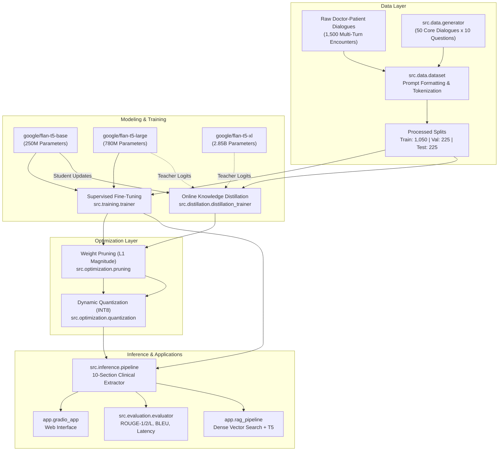
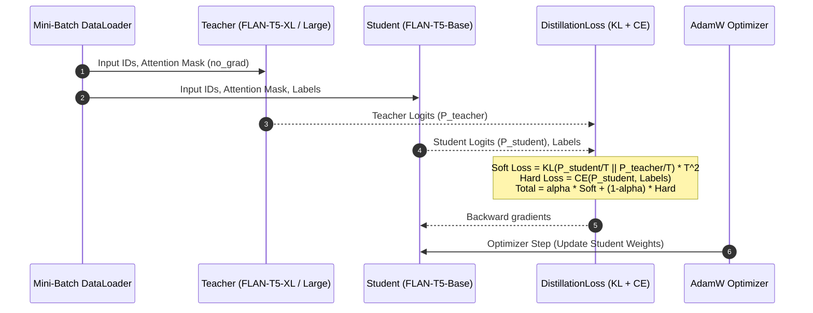

# Architecture & Technical Design

This document details the system architecture, data processing pipeline, knowledge distillation framework, and inference flows.

## 1. End-to-End System Architecture



## 2. Sequence-to-Sequence Prompt Formulation

FLAN-T5 is an encoder-decoder model operating in text-to-text space. Input dialogues and queries are structured into a standardized template:

```
Question: {Target Clinical Question} Context: {Doctor-Patient Dialogue Transcript}
```

The decoder predicts the concise clinical answer corresponding to one of the 10 target categories:
- Brief History
- Chief Complaints (comma-separated values)
- Past Medical History
- Hospitalization & Surgical History
- Gynecological History
- Lifestyle & Social Activity
- Family History
- Allergies & Hypersensitivities
- Previous Investigations
- Review of Systems (ROS)

## 3. Online Knowledge Distillation Mechanics



## 4. Pruning and Dynamic Quantization

1. **L1 Unstructured Pruning**: Zeroes out weights with the smallest absolute values in all `nn.Linear` layers across both encoder and decoder self-attention and feed-forward blocks.
2. **Dynamic INT8 Quantization**: Converts float32 weights of Linear modules into signed 8-bit integers (`qint8`), reducing serialized disk size by 58.9% and in-memory parameter tensor allocation by 78.6%, noting that CPU inference latency in eager PyTorch execution increases (+67.0% in our benchmark) due to per-step dynamic quantization/dequantization overhead.
